# V03-003 — Paquete de revisión humana

Estado: propuesta implementada, checkpoint visual PENDING. GO WITH CONDITIONS técnico, sujeto a CI final. No favicon/manifest ni merge automático. V03-005 no iniciado.

Revisar identidad Innergex, jerarquía, espacio operativo, Dark/Light, etiquetas del rail, mobile320, drawer y reconocimiento de B a16/24/32. Las superficies de contenido son las existentes.

## Desktop Light / expanded / Overview

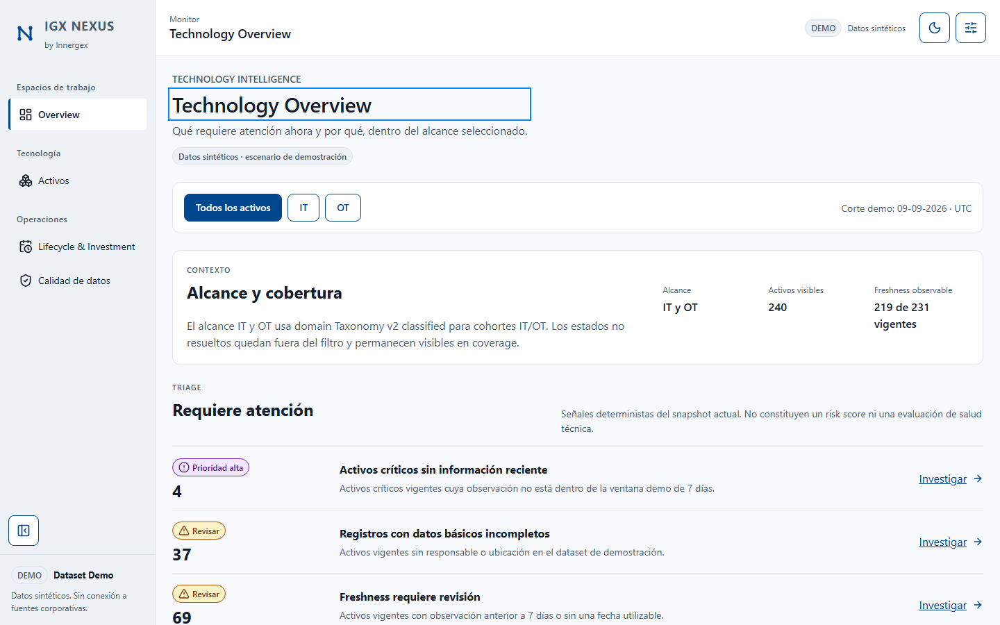

## Desktop Dark / Overview

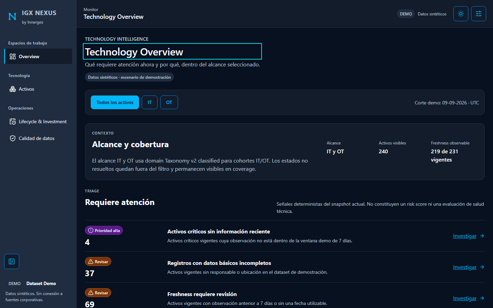

## Dark Compact / datos densos

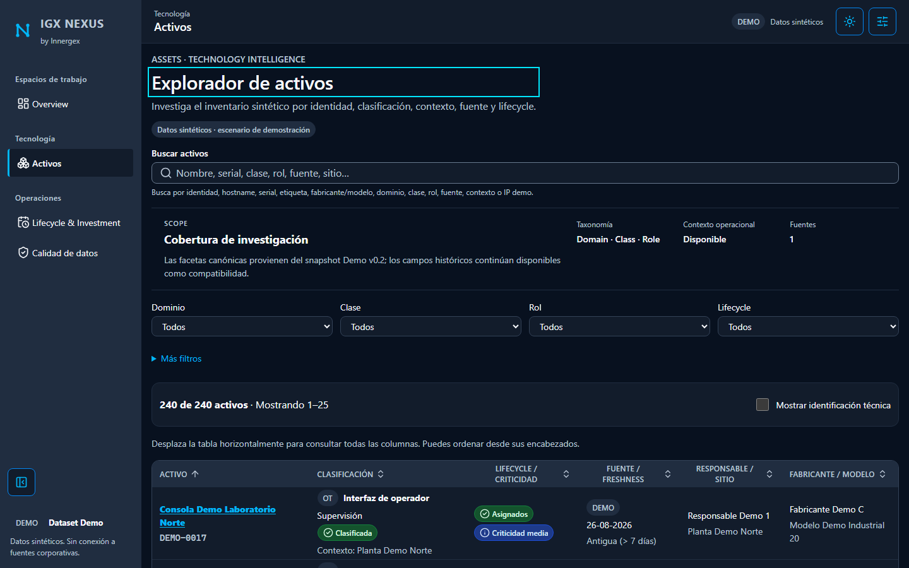

## Tablet768

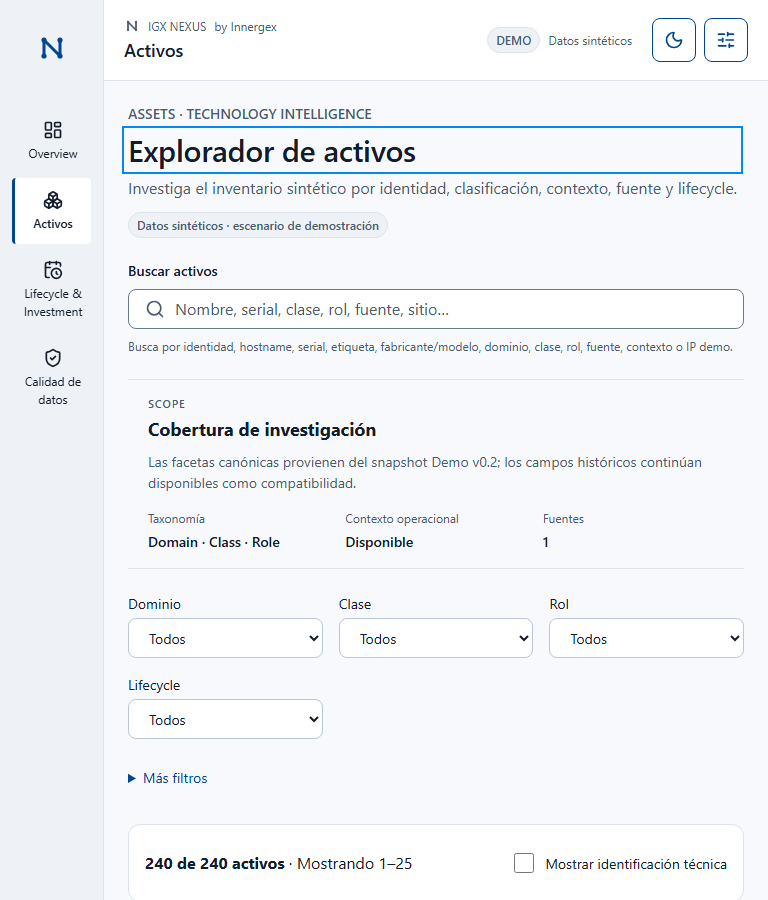

## Mobile320

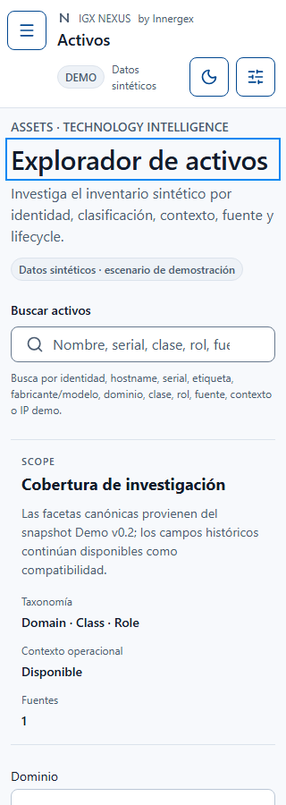

## Collapsed / rail etiquetado

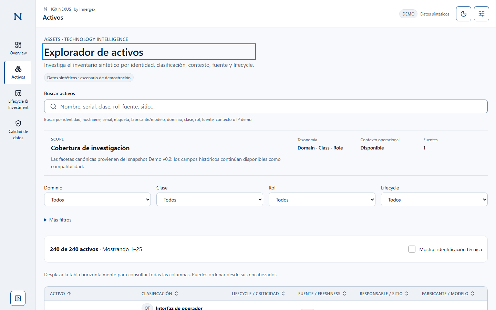

## Mobile drawer

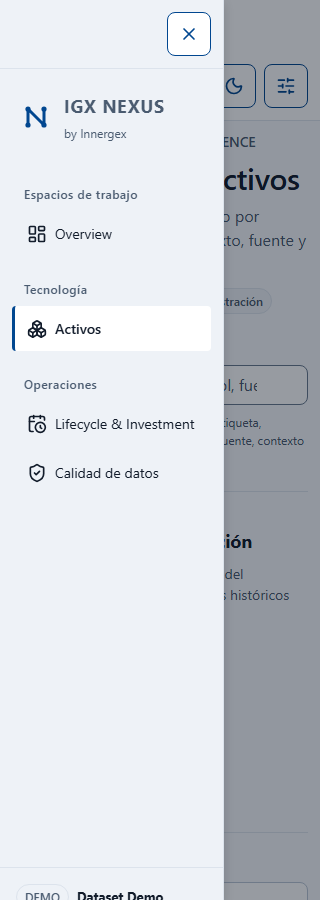

## Current + focus

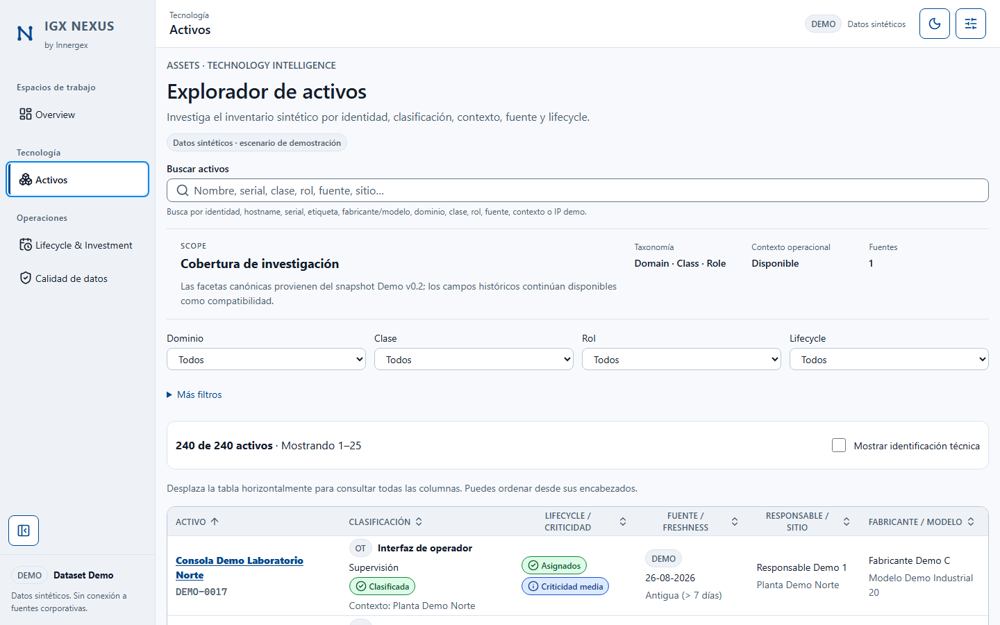

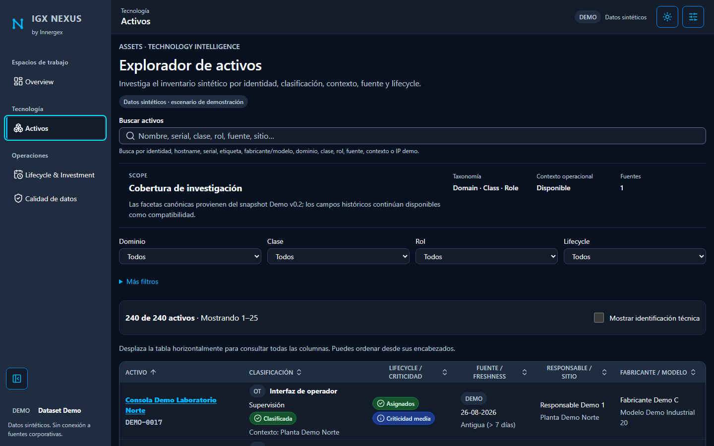

## High Contrast emulado

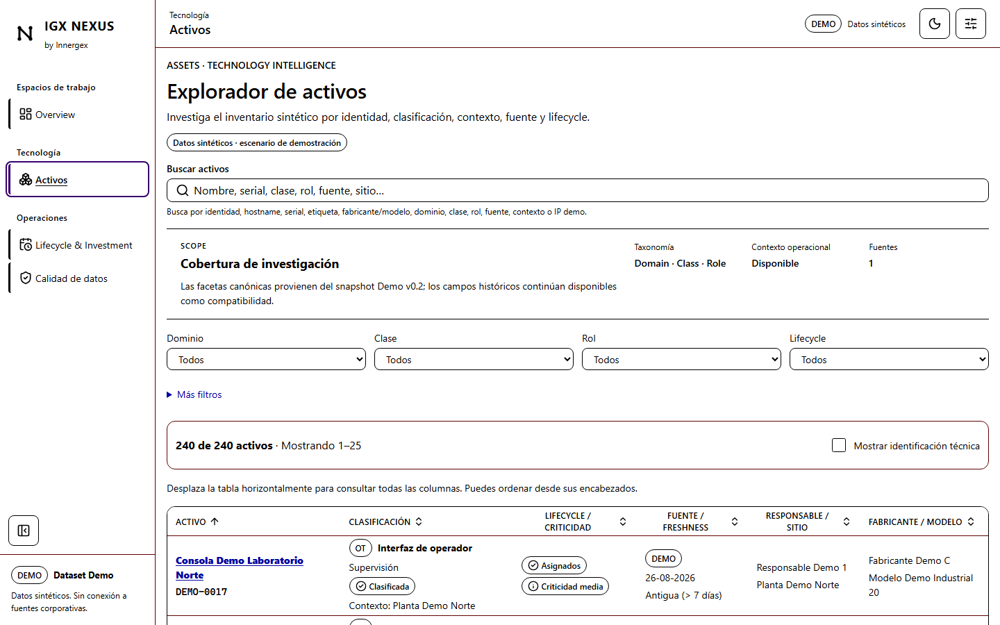

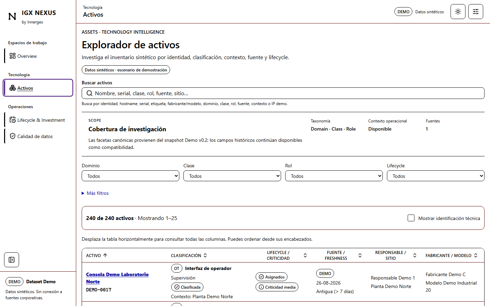

## Mark B refinado · no definitivo

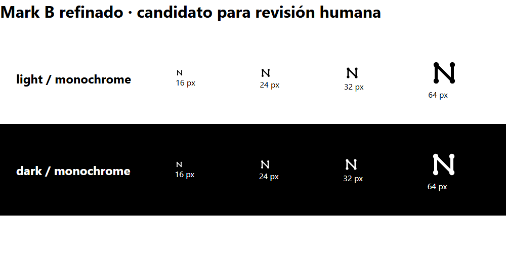

Manifest con viewport/tema/densidad/URL: [manifest.json](manifest.json). No baseline visual aprobado ni certificación WCAG. Evidencia y limitaciones técnicas: [contrato del shell](../../v0.3-shell-navigation.md). Resultado CI final y SHA se registran en el Draft PR.