# V03-003A — Human review package

V03-003 VISUAL CHECKPOINT = **NOT APPROVED**. PRODUCT DIRECTION PIVOT = **APPROVED**. Nueva propuesta003A pendiente de revisión humana. PR138 OPEN/DRAFT / TECHNICAL SHELL PROTOTYPE; no merge. V03-005 NO INICIADO.

[Capability matrix](../../v0.3-universe-capability-matrix.md) · [Product IA + visual diagram](../../v0.3-product-universes.md) · [Experience direction / motion / a11y / performance](../../v0.3-spatial-experience-direction.md) · [Technology/brand research](../../v0.3-spatial-technology-research.md).

## Reproducible prototype

[Abrir laboratorio local](http://127.0.0.1:3023/prototypes/v03-003a/) si el servidor está activo. Instrucciones reproducibles: [README](../../../../prototypes/v03-003a/README.md). Ambos recorridos con controles explícitos “Recorrido IT/OT” y “Siguiente paso”; motion200/320ms y equivalent reduced. Capturas estáticas no demuestran motion; ejecutar laboratorio.

Fixtures DEMO CONCEPT:8 CIs,7 relaciones,1 contexto site y2 versiones Software concept; no datos corporativos ni nueva ingestión. Observed/Inferred en los enlaces describen fixtures authored. Live actual no tiene esas relaciones/instalaciones/site registry.

## Galería

### Global Desktop Light
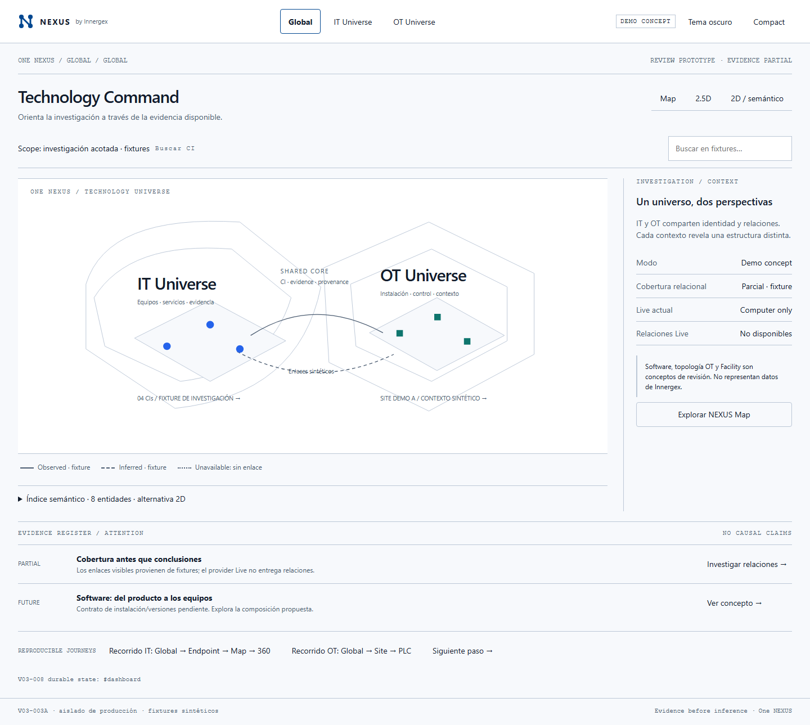

### Global Desktop Dark
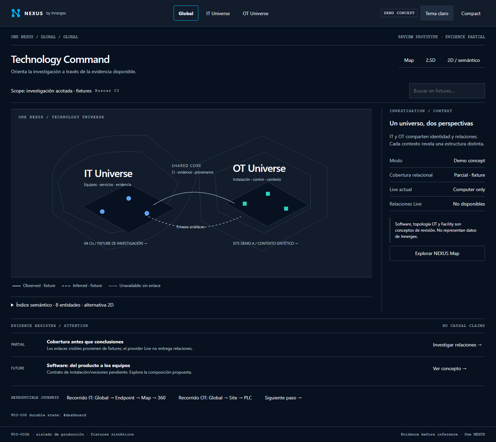

### IT Universe
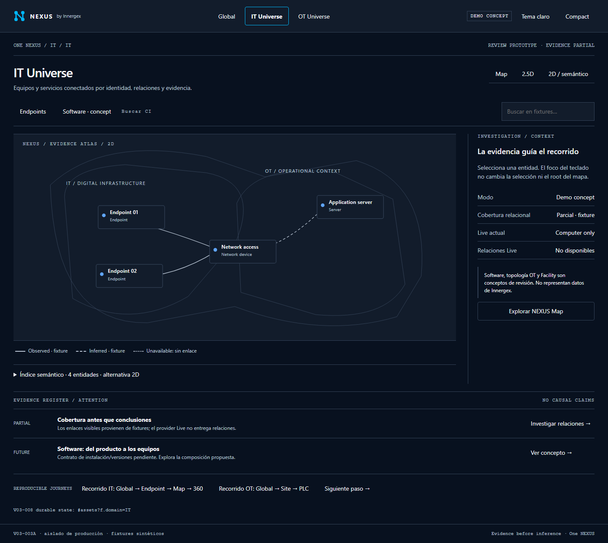

### OT Universe
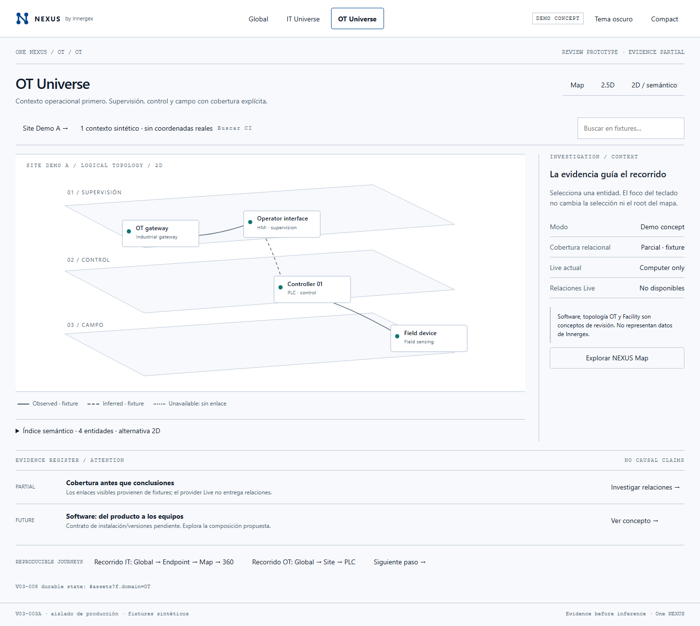

### Software Workspace concept — FUTURE
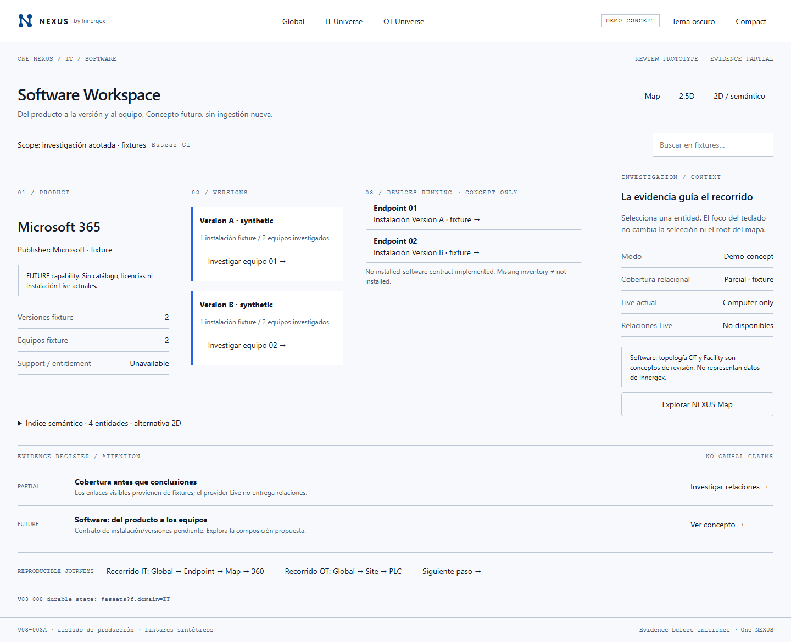

### Facility / OT topology concept
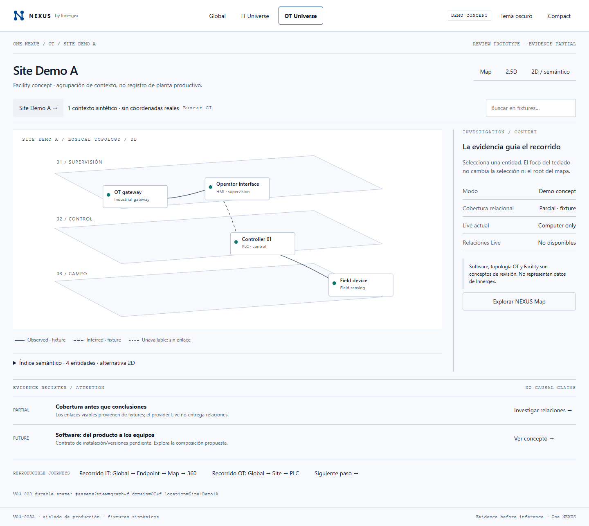

### NEXUS Map — selected entity
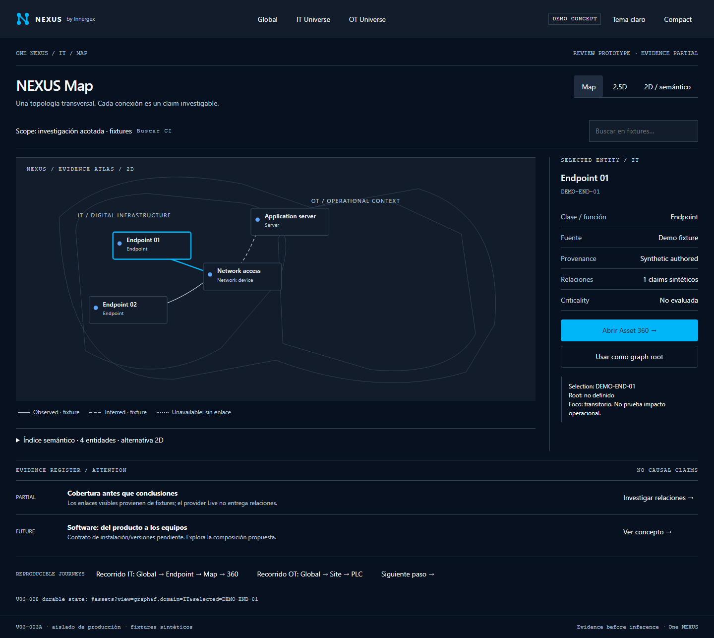

### Controlled2.5D experiment
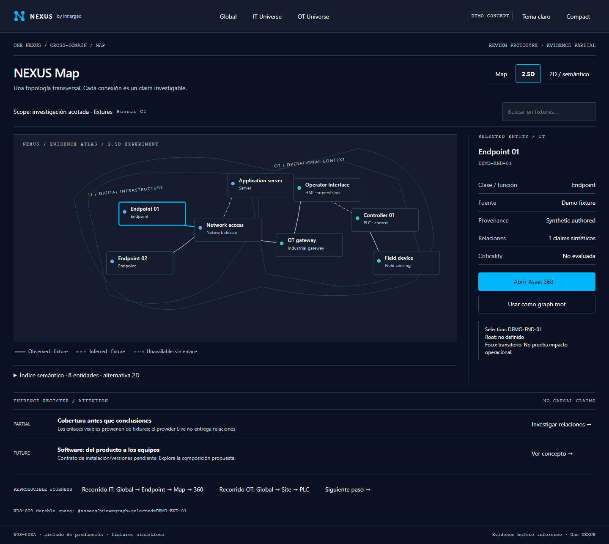

### Mobile concept
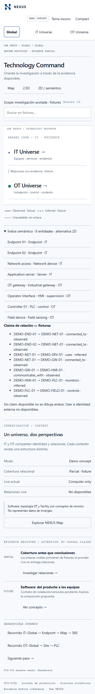

### Asset identity continuity
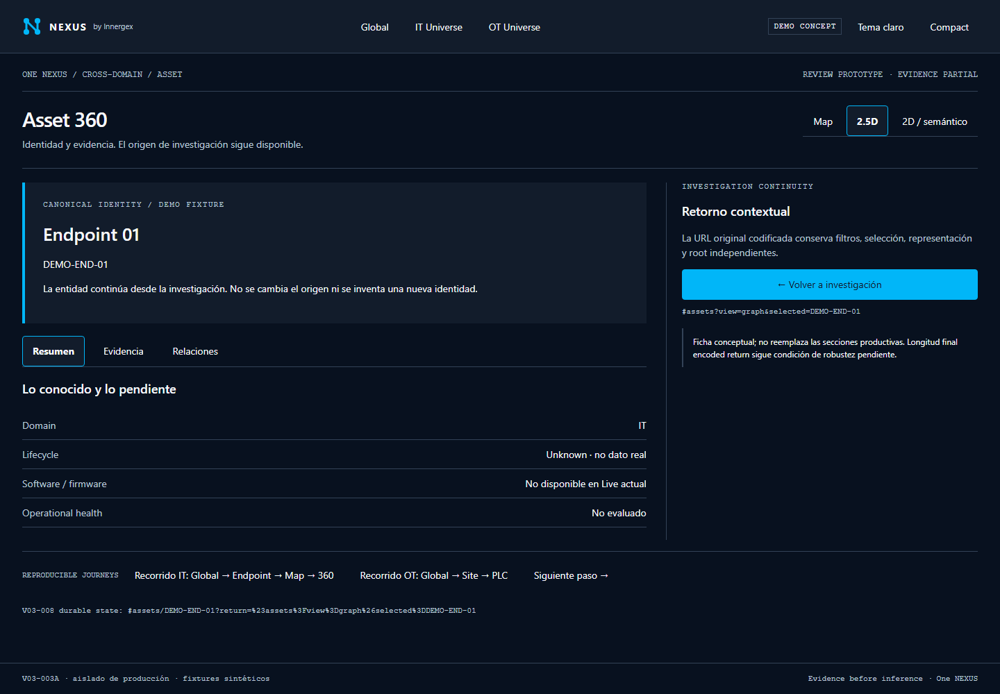

### Mobile forced colors / reduced — emulated
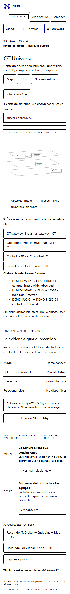

## Verificación y límites

[Manifest](manifest.json) registra fecha, viewport, theme, hashURL ySHA256 de cada captura. Script capture verifica journeys, URLs, selectedId, representación,360/return/refresh, Back/Forward, keyboardselection, reflow320 y mediaemulation;11 capturas y0pageerrors. No auditoría completa de accesibilidad ni usertesting. [Microbenchmark](benchmark-results.json) describe metodología y muestras observadas; ningún benchmark de biblioteca/tenant/corporate scale. Evidencia histórica #138 no se reemplaza ni se confunde con aprobación estética.

## Decisión solicitada al finalizar fase

Recomendación **GO WITH CONDITIONS** para reanudar V03-003, sujeta a aceptación humana de:

1. Atlas Global + composiciones IT/OT reconocibles sin depender del logo.
2. Composición Software/Facility expresa capacidad FUTURE/FOUNDATION sin simular producción.
3.2.5D mejora orientación frente a2D; si no, elegir2D.
4. Migración incremental de #138 preservando contratos/focus/responsive/DS y sin iniciar005 automáticamente.

No se ejecuta implementación final ni merge desde esta recomendación.
