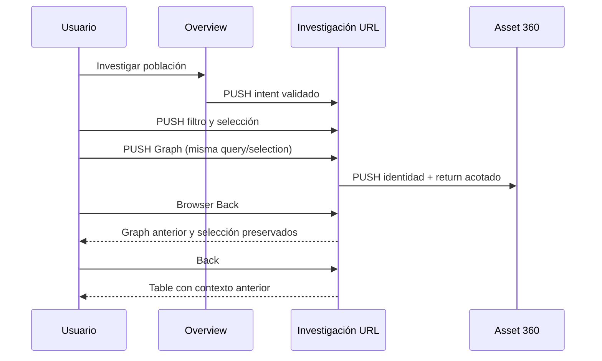

# V03-008 — Cross-Surface State & Navigation Contract

Baseline verificado: `main@e04c4025dc3764bc668a6155df883e275c0519f6`, merge de PR #136. Rama `feature/v03-008-cross-surface-state-navigation`. **Propuesta implementada para checkpoint humano; no aprobación automática ni cierre del ticket.** V03-003/V03-005 no iniciados. V02-023 separado.

## Auditoría del estado actual

OBSERVED aquí significa inspección del código en baseline; la evidencia browser nueva se distingue en Validación. V03-001 se consultó en sus entregables históricos fuera de Git; V03-002 completo en `docs/design-system/v0.3-*`. Las decisiones de marca B/A/C permanecen intactas.

| Evidencia en apps/web/src | OBSERVED en baseline | INFERRED / riesgo | RECOMMENDED y cambio de V03-008 |
|---|---|---|---|
| navigation-model.ts, App.tsx; ADR-0006 | Router propio de hashes, AppRoute discriminado; anchors HTML y hashchange; rutas #overview/#assets/#health/#lifecycle/#assets/:id/relations/label/#q/:locator | Cambiar router exigiría compatibilidad con anchors/servidor sin necesidad demostrada | Mantener parser/enlaces; admitir query en #assets, observar popstate y notificar pushState/replaceState propios |
| AssetExplorer.tsx, explorer-model.ts | Search + 14 facetas, sort/page/size locales; carga del provider reinicia página; AND entre filtros y palabras; explore deriva/clampa resultados | Desmontar pierde investigación; refresh tampoco reconstruye filtros | Adaptador URL habilitado en App; mismos cálculos; clamp de página tras recibir snapshot mediante REPLACE |
| AssetTable.tsx | Enlace de identidad abre #assets/:id; no selección compartida implementada por Explorer | No existe contrato de origen de esa ficha | AssetLink contextual conserva snapshot de la investigación y CI elegido; click normal captura ese CI con REPLACE en origen antes del enlace PUSH, modificadores/new-tab conservan semántica nativa; sin convertir filas en targets ambiguos |
| RelationshipGraph.tsx, relationship-model.ts; ADR-0008 | root es assetId; depth/type/perspective/selected en hash; copia local mapState; selección fuera de nodeIds se borra con replace; filtros borran selección | Dos owners/correcciones silenciosas son incompatibles con futura convergencia | Contrato nuevo conserva selección y calcula disponibilidad; renderer legacy no migrado aún |
| Asset360.tsx | Identidad y cuatro secciones estables; foco h1 o heading de sección; breadcrumb Activos hardcodeado | Retorno explícito pierde origen aunque browser Back recupere URL | return interno validado; breadcrumb contextual y tabs conservan return; deep link directo sigue funcionando |
| Dashboard.tsx, overview-model.ts | Dominio local all/IT/OT, cohortes clasificadas; CTA Explorer genérico | CTA no transmite población investigada | CTA representativo usa InvestigationIntent con domain + taxonomyState=classified cuando IT/OT; no inventar filtro de atención sin contrato |
| LifecyclePlanning.tsx, CmdbHealth.tsx | Horizon local; filtros/página Quality locales; enlaces de entidades sin origen | Investigaciones especializadas no comparten aún el nuevo contrato | Migración posterior por adaptador; no serializar métricas/causas inexistentes |
| ItOtIntelligenceSummary, EndpointExperienceSummary, ProactiveFindingsSummary, KnowledgeResearchPanel | Link Explorer genérico, findings a assetHash; research disclosure/review React local; links externos explícitos | No se debe transportar toda hipótesis, métrica o revisión como URL | Reutilizar intent tipado para destinos representables; conservar comportamiento actual hasta ticket consumidor |
| App.tsx, data-mode-guard.ts; ADR-0014/0023 | VITE_NEXUS_DATA_MODE decide composición al arrancar; snapshot validado; no runtime switch | URL mode=demo podría aparentar cambio de fuente si se aceptara | Modo fuera del contrato URL; query no cambia provider; no fallback Live→Demo |
| NexusShell.tsx, shell-preferences.ts, AppShell | Tema/densidad localStorage + preferencia sistema; drawer móvil transitorio con Escape/restore; skip anchor #igx-main-content | Confundir preferencias o drawer con investigación añade owners innecesarios | Conservar shell y preferencias; ningún cambio de branding, drawer o arquitectura de datos |

## Ownership y taxonomía

**STATE MUST HAVE AN OWNER.** InvestigationState es una proyección tipada de la URL, no un segundo store. No duplicar selectedId dentro de graph. AppRoute es proyección de ruta; su cache React/history legacy no tiene precedencia sobre una URL válida.

| Estado | Clase / owner | Vida / almacenamiento | URL; refresh; share; Back/Forward | Invalidación |
|---|---|---|---|---|
| scope=inventory | Durable; URL | Entrada de investigación; provider limita población efectiva | Sí; default omitido | Scope desconocido → inventory + diagnóstico; no nuevo tenant/source |
| search / 14 filters | Durable; URL | Hasta cambio explícito | Sí en adaptador Explorer y harness | Sintaxis inválida → default diagnosticado; valor de faceta obsoleto se conserva, muestra cero matches/opción sin coincidencias |
| view table/graph | Durable; URL | Hasta cambio explícito | Sí en contrato/harness | Graph productivo todavía no integrado: tabla alternativa con aviso, mantiene view solicitado |
| sort/page/pageSize | Durable; URL | Contexto table conservado durante graph | Sí | Sort inválido default; page entero positivo ≤999999, size 25/50/100; página obsoleta clamp por resultado con REPLACE |
| selectedId | Durable; URL | Hasta selección/deselección explícita | Sí | No borrar por falta de datos/scope; disponibilidad derivada y mensaje |
| graph.rootId/depth/type/perspective | Durable específico de representación; URL | Conservado cuando table está activa | Sí | Root desconocido no se inventa; root vacío pide selección; depth 1/2; enums actuales |
| Asset360 identity/section | Durable; URL existente | Ruta de entidad | Sí | ID ausente del snapshot → no encontrado; sección inválida → summary |
| return | Durable; URL de ficha | Origen canónico acotado, sin recursión | Sí; sección preserva origen | Sólo #assets con contrato válido; externo/duplicado/inválido → #assets fallback |
| mode / provider / snapshot | Aplicación/datos; composición existente | Startup + ciclo del provider | No en URL; no alterado por navegación | Unavailable/error explícito; jamás Demo fallback |
| DOM focus, hover, scroll, expanded row, popover, drawer | Session interaction; consumidor/DOM | Montaje/interacción; no store global | No; no share ni promesa de restauración pixel exacta | Destino accesible deliberado, fallback si nodo no existe |
| light/dark, compact/comfortable, mostrar identificación técnica | Preferencia; shell storage existente / toggle local Explorer | Tema/densidad persistidos; toggle técnico sólo montaje actual | No en URL | Preferencias no reemplazan investigación; no persistencia nueva para toggle |
| rows/counts/facets/page efectiva/graph membership/availability | Derived; funciones sobre snapshot + estado | Recalculado; no copiar a URL | No | Nuevos datos recalculan sin fabricar identidad/relaciones |

No scope organizacional arbitrario ni array multiselección: inventario disponible + facetas escalares es el contrato realmente existente. El vecindario relacional es una restricción de representación derivada del root, no otra fuente de scope.

## Contrato público de URL

Se extiende **#assets**, no se crea /technology ni se migra a BrowserRouter. Fragment query usa URLSearchParams; Unicode/espacios/+/% se codifican una vez (espacio → +, literal + → %2B). ID en path conserva encodeURIComponent del contrato previo.

Orden determinista: view, scope, q, f.<filterKey> en orden de filterKeys, sort, direction, page, size, selected, root, depth, type, perspective. Omisión de defaults: table, inventory, búsqueda/filtros vacíos, name/ascending, page1/size25, sin selección/root, depth2/typeall/perspectiveall. Graph constraints se conservan también en table para retorno reproducible.

- Enums: view=table|graph; scope=inventory; direction=ascending|descending; sort usa columnas soportadas por explorer-model. Graph conserva depends_on/uses/connected_to y upstream/downstream/peer.
- Booleanos de facetas usan valores **yes/no** del modelo actual, no truthiness JS; __missing__ conserva significado. Facetas son strings de dominio, no JSON ni IDs upstream reinterpretados.
- Arrays no soportados: cada parámetro es singular; duplicados se rechazan con diagnóstico, independiente del orden. Unknown parameters se omiten al canonicalizar, con diagnóstico; no habilitan modo, foco ni preferencias.
- Límites: hash4096 caracteres, q256, facetas/IDs160; controles C0/DEL y encoding mal formado rechazados. URL excesiva produce default seguro + diagnóstico, nunca redirect en bucle. Los helpers consumidores están tipados; normalize valida runtime vía parser. No hay schema/backend nuevo.
- Valores de faceta retirados permanecen activos con cero resultados y acción de reset; eliminarlos silenciosamente ampliaría población. Sintaxis/enums desconocidos se degradan con aviso; no hay claim de equivalencia con la búsqueda original inválida.
- Enlaces pueden incluir términos/IDs del inventario: no incluir secretos, payloads de evidencia, nombres de fuentes administrativas ni tokens. URL no confiere acceso ni cambia provider. Enlace compartido requiere entorno/permisos adecuados y puede no resolver la misma entidad en otro dataset.

Ejemplos canónicos:

```text
#assets
#assets?q=router&f.domain=OT&f.taxonomyState=classified
#assets?q=router&f.domain=OT&page=3&selected=NEXUS-42
#assets?view=graph&q=router&f.domain=OT&page=3&selected=NEXUS-42&root=NEXUS-42&depth=1&type=uses
#assets/NEXUS-42
#assets/NEXUS-42?section=evidence&return=%23assets%3Fq%3Drouter%26selected%3DNEXUS-42
```

Último ejemplo corresponde a buildContextualAssetLink; deep link directo sin return conserva breadcrumb Activos. Las rutas #assets/:id/relations, /label, #q y anchors dashboard continúan válidas. No redirects nuevos. Parámetros de rutas legacy no se renombran. Futuras extensiones aditivas; cambio incompatible exige nuevo parser/versionado explícito, no reinterpretación silenciosa de valores.

## Precedencia e historial

1. La URL actual válida decide investigación y ruta, incluso frente a history.state/localStorage.
2. Intent explícito **produce una nueva URL** validada; nunca un overlay oculto que compita con URL.
3. Defaults del parser completan campos omitidos; no rescatar filtros de otra sesión.
4. Preferencias pertenecen a otro eje. history.state.nexusRoute sólo sigue como fallback legacy para anchors no reconocidos según ADR-0006; no aporta filtros/selección del contrato nuevo.

| Acción | History | Regla |
|---|---|---|
| Overview CTA, entidad/section/context return, table↔graph, selección explícita, filtro/orden/page/size | PUSH | Entrada significativa; no duplicar URL idéntica |
| Search mientras escribe o clear del Search | REPLACE | Búsqueda inmediata como hoy; coalescea entrada actual, sin una entrada por tecla |
| Normalización de página tras dataset, captura de CI al abrir ficha desde Explorer | REPLACE | Corrección o captura del origen antes del PUSH de entidad, no paso adicional |
| Viewport/hover/focus/drawer/theme/density | Ninguno | No navegación semántica |

Tradeoff search: Back restaura entradas significativas previas, **no cada prefijo ni la búsqueda anterior dentro de la misma entrada reemplazada**. No timer/debounce adicional: en inventario actual el filtro ya es local/inmediato. Un futuro dataset grande requerirá medir y quizá draft + commit/debounce con flush antes de navegar; no introducirlo sin demanda. Los helpers memoizan parsing por hash; push/replace nativos no generan hashchange, por eso se emite nexus:navigation, además de escuchar popstate/hashchange. El evento sincroniza proyecciones; no contiene copia de estado.



Filtro A → filtro B → Back recupera A. Forward recupera B. Navegar 360 y usar Back no agrega un return sintético al historial; breadcrumb contextual es un enlace normal y **sí** crea entrada. No usar history.back() para breadcrumb sin saber si existe origen NEXUS; deep link directo puede venir de otro sitio.

## Table ↔ Graph: dos alcances, una selección

Se comparten scope inventory, query, facetas, selección, sort/page/size retenidos, navegación URL y contexto de investigación. Root/depth/type/perspective son específicos del graph y se conservan entre representaciones. Cambiar view no borra filtros ni selección. Primera entrada a graph puede adoptar selectedId como root; sin selección no se elige el primer asset. Cambiar selección después no cambia automáticamente root.

Disponibilidad de selección: none; source-unavailable; graph-unavailable (sin cobertura relacional); missing en inventario; outside-filter; outside-graph; visible. Función pura, no mutación ni corrección de URL. Fuera de filtros tiene prioridad diagnóstica sobre fuera de graph; consumidor futuro puede añadir motivos complementarios. Partial graph no es ausencia empresarial de relaciones. Sin provider relacional se debe mostrar unavailable, no inventar nodos/edges.

No asumir que facets y graph recortan el mismo conjunto: inventario filtra entidades; graph focal incluye conectados necesarios como contexto, etiquetados fuera de filtro por consumidor futuro. Filtros de relación no se aplican a table; filtros de inventario se conservan incluso si el graph no puede representarlos. Nunca ignorarlos sin aviso. V03-005 debe diferenciar counts de inventario y vecindario, coverage y provenance.

Graph→Table conserva página previa. Si selectedId no está en esa página, se conserva y ofrece disponibilidad/identidad, **no salto automático de página, scroll virtual ni foco mágico**. Asset 360 retorno enfoca link de identidad cuando existe en página; en otro caso resumen de resultados. Evita escanear/paginar toda la colección sólo para ubicar una selección. V03-007 sólo implementará representación dentro de V03-005, sin store paralelo.

## Asset 360, Investigation Intent y accesibilidad

buildInvestigationLink recibe query, filtros tipados, selección y view opcional. Scope inicial es el inventario disponible de la aplicación. Origin provenance no se serializa como hipótesis/report completo: el enlace identifica contexto reproducible; el caller conserva su supporting explanation. Overview adopta un CTA representativo con dominio clasificado; Lifecycle/Quality/Endpoint/Findings/Research podrán usarlo sólo para filtros realmente existentes. No rutas por tarjeta ni falsas equivalencias entre atención y criticidad.

buildContextualAssetLink usa ruta estable + **return de fragmento interno**, una sola capa de encoding y sin JSON. URL de 360 compartida/refresh mantiene origen. return acepta sólo #assets válido; enlaces externos, anidados, duplicados, desconocidos o excesivos se rechazan. Se conserva entre las cuatro secciones. QR/label y renderer Map legacy no migran contexto todavía; documentados como impacto pendiente.

Selection ≠ Focus ≠ Graph root. DOM focus nunca URL. Asset 360 conserva h1/heading de sección; Explorer initial route conserva foco h1 y al retorno intenta enlace CI visible, luego resumen; no roba foco al escribir filtros. Harness enfoca heading de representación al cambiar view y nodos/button tienen aria-pressed independiente. V03-005 deberá decidir selector de representación semántico, anuncio breve de resultados, keyboard/lista equivalente y retorno de panel; no afirmar que el harness certifica ese renderer.

Loading/error/empty pueden no tener el destino de foco: no deshabilitar Back ni borrar selección. No animación nueva; reduced motion conserva navegación. Tema/densidad siguen siendo preferencias y drawer/viewport interacción local. Resize no altera URL; si graph completo no es utilizable en mobile, representación semántica mantiene intención y selección con aviso, sin reescribir view silenciosamente. El renderer legacy ya oculta plano gráfico bajo768 y mantiene lista; el harness valida contrato semántico a320, no Map3.0.

## Implementación, performance y estrategia de migración

Código: navigation-state.ts (schema/parser/serializer/normalize/intent/return/availability), use-investigation-navigation.ts (suscripción URL única + history). Reutiliza ExplorerQuery, filterKeys, explore y enums Map actuales. Sin router/state library/dependencias/backend/providers nuevos. Parsing acotado O(longitud URL +14 facetas), memo por hash. Ningún layout/cálculo graph disparado por sincronización; consumers pueden calcular resultados al cambiar estado como antes. selectionAvailability deriva inventario; no usarla como scan duplicado para grandes datasets sin medir/indexar. Dataset Demo240 no prueba escala corporativa.

Migración incremental:

1. Esta foundation + adaptador Explorer, retorno 360 y CTA Overview representativo; mantener rutas y lógica legacy.
2. V03-003 revisa navegación dentro del contrato aprobado, sin declarar nuevas fuentes.
3. V03-005 monta representación table/graph con un único owner URL y elimina copia local/control reset del graph legacy sólo al migrar consumidor y tests. V03-007 pertenece a esta representación.
4. Adaptadores de superficies especializadas + acciones QR/label/contextos secundarios; no migración masiva aquí.
5. Performance con topologías reales/sintéticas mayores, graph semantic alternative y auditoría a11y por superficie antes de cierre de UI final.

Tradeoffs: hash compatible sin rewrites; URL legible a costa de longitud; return repetido explícito sobre singleton opaco; facets escalares actuales sobre multiselección anticipada; harness sobre integración visual prematura; Graph deep link nuevo muestra fallback table con aviso mientras no hay renderer integrado. Renderer legacy permanece con su contrato previo y por tanto aún puede borrar su propia selección: no afirmar convergencia productiva hasta V03-005.

## Validación y checkpoint humano

Tests ejecutables: navigation-state.test.ts + NavigationContract.browser.test.tsx + tests/navigation-refresh.test.mjs (recarga física, 2/2 PASS local); regression Asset360 actualiza únicamente URL exacta de retorno contextual. Cubren defaults/roundtrip/encoding/enums/duplicados/límites/unknowns; preservación query/filtros/selection/tablepage/graphparams; stale/missing/outside-graph/source-unavailable; enlaces externos inválidos; Overview→filter→select→Graph→360→Back/Forward; A→B→Back; replace search; deep link/remount; responsive320; integración Explorer→360→section→return y foco. Remount prueba reconstrucción React desde URL, **no por sí solo reload físico del navegador**. Evidencia de build/CI y prueba de refresh real se registran en handoff/PR con resultados observados, sin inventarlos.

CI de implementación `21480ce6c904639051751b9f58a38c627acbc3cb`: [SUCCESS, run 37482463481](https://github.com/serarayaa/igx-nexus/actions/runs/37482463481), Web358/358, Storybook54/54, foundation4/4, refresh2/2, readiness1/1 y gates contratos/API/QA existentes. CI del HEAD final se registra en [PR #137](https://github.com/serarayaa/igx-nexus/pull/137). No confundir este resultado Linux con los timeouts locales documentados en handoff.

Presentar esta matriz ownership, ejemplos, diagrama, reglas Table/Graph/360, escenarios Back/Forward/invalid/stale y resultados antes de cerrar. **GO WITH CONDITIONS** propuesto sólo tras checks verdes: checkpoint humano pendiente, migración graph condicionada a scope/coverage/performance/a11y y contratos existentes. No iniciar V03-003/V03-005 automáticamente; merge manual de Sergio. Sin compliance WCAG absoluto ni conclusiones Live real.

Fuentes primarias consultadas: [WHATWG HTML — History](https://html.spec.whatwg.org/multipage/nav-history-apis.html#the-history-interface), [WHATWG URL — URLSearchParams](https://url.spec.whatwg.org/#interface-urlsearchparams), [React — useSyncExternalStore](https://react.dev/reference/react/useSyncExternalStore). History y URL aportan mecanismos de plataforma; ownership/políticas son decisiones del producto, no reglas copiadas de otra aplicación.
