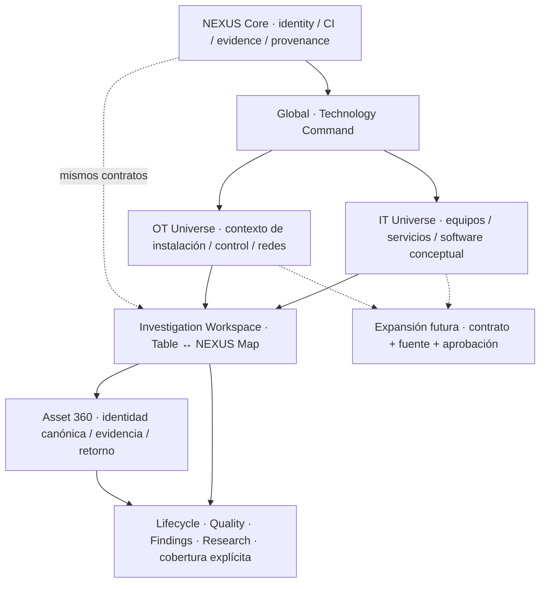

# V03-003A — ONE NEXUS / Product universes

**V03-003 VISUAL CHECKPOINT = NOT APPROVED. PRODUCT DIRECTION PIVOT APPROVED.** PR #138 permanece OPEN / DRAFT como **TECHNICAL SHELL PROTOTYPE**. Esta propuesta no aprueba ni implementa la dirección visual final. V03-005 NO INICIADO.

## Arquitectura de producto propuesta

ONE NEXUS es una identidad y un modelo de evidencia compartidos, con composiciones por dominio. Global no es otra aplicación: es la entrada para orientar investigación entre IT y OT. “Universe” describe la organización de una experiencia, no un nuevo provider, inventario o router.

## Propósito y composición

| Contexto | Pregunta | Composición distintiva | Capacidad/gap |
|---|---|---|---|
| Global | ¿Qué tecnología podemos explicar y dónde falta evidencia? | Atlas de dominios, conexiones conocidas, registro de atención y cobertura en el mismo campo; nada de colección de KPI cards | Datos canónicos actuales; ningún cambio temporal sin historial |
| IT | ¿Qué equipos y servicios conforman este ecosistema? | Constelación de endpoints/servers/network, índice preciso y inspector contextual; software como lente conceptual | Computer Live soportado; network/installs fuera de Live actual |
| OT | ¿Qué tecnología sostiene el contexto de una instalación? | Plano lógico de contextos site, estratos supervisión/control/campo y enlaces con evidencia | No plano geográfico, proceso, disponibilidad operacional ni registry Facility actual |
| Software | ¿Qué versiones llegan a qué equipos y con qué cobertura? | Flujo producto → versión → instalación → CI, lista explícita y evidencia | Concepto futuro; Demo no es promesa de ingestión |
| Map | ¿Qué relación documentada conecta estas entidades? | Mismo alcance de investigación, niveles semánticos y representación 2D equivalente | No conectividad fabricada ni impacto transitivo inferido |
| Asset360 | ¿Qué sabemos de esta identidad y por qué? | Entidad seleccionada continúa desde el mapa hacia ficha; origin/return visible | Mantener secciones actuales y limitación Computer Live |

IT organiza por familia y tarea de investigación; OT por contexto de instalación y función operacional. Ambas composiciones consumen la misma entidad, no duplican CIs ni rebautizan un filtro como sistema de control. Cuando falta contexto OT, mostrar “contexto no disponible” y un inventario semántico; no dibujar una planta ficticia en Live.

## Jerarquía y navegación

1. Barra estable pequeña: identidad B, switcher Global/IT/OT, búsqueda de investigación, modo Demo/Live, tema/densidad.
2. Command surface orienta hacia dominio o población; no todas las dimensiones son destinos de menú.
3. Cada dominio tiene índice local (familias/contextos) y una investigación activa; Map/Table son representaciones.
4. Inspector revela entidad/evidence; Asset360 conserva retorno contextual.
5. Quality, Lifecycle, Findings y Research aparecen donde hay pregunta/evidencia, manteniendo rutas actuales hasta migración aprobada.

Global→IT y Global→OT son acciones significativas; intención produce URL válida V03-008. Domain `IT/OT` es faceta soportada, no nuevo scope. Facility sólo puede traducirse a filtro soportado con mapping explícito; operationalContextId no se agrega silenciosamente al parser.

**Selection != Focus != Graph root.** Cambiar universo no vuelve seleccionado al root; root se cambia por acción explícita. Browser Back/Forward restaura URL; hover, perspectiva visual 2.5D, theme, density, drawer y foco no escriben InvestigationState. Search REPLACE; entidad/filtro/representación PUSH. Mantener límites actuales y el seguimiento Asset360 encoded return length.

## Journeys prototipados

IT: Global → IT → Endpoint DEMO-END-01 → Map (misma selection) → Asset360 → retorno Map. La URL usa helpers reales de navigation-state.ts. OT: Global → OT → Facility “Site Demo A” (contexto sintético) → OT Topology → Controller DEMO-PLC-01 → ficha. En OT el site no es un CI nuevo: agrupación contextual; los controladores sí son CIs sintéticos.

Software: IT → Software concepto → Microsoft 365 fixture → versión fixture → equipo fixture → Asset360. No implica entitlement M365/Entra, licencias verificadas ni catálogos Live. Las vistas Software y Facility son presentaciones del laboratorio; no nuevas rutas productivas.

## Identidad futura y expansión

Identity de NEXUS significa identidad canónica de entidades y aplicación, no un directorio User/Entra ya integrado. Una cadena User→Endpoint→Network→Server→Firewall→Gateway→SCADA→PLC→Facility requiere claims individuales y coverage. User y operational physical asset hoy no tienen entidad canónica propia; Facility es referencia contextual. En Live actual relaciones=[]: mostrar ausencia de evidencia, no dibujar el ejemplo como topología observada.

La expansión incorpora nuevos dominios sólo después de modelo, source adapter, permisos, provenance y consumer verificables. V02-023 Intune mantiene su dependencia externa; no se absorbe en esta propuesta.

## Evolución de #138 sin destrucción

| Foundation | Decisión |
|---|---|
| V03-008 helpers/history/URL | PRESERVE; no store/router paralelo |
| Drawer, inert, trap, Escape, restore/skip focus | PRESERVE; adaptar composición después de aprobación |
| Light/Dark, Comfortable/Compact, V03-002 | PRESERVE; resolver nuevas superficies por roles existentes |
| Mark B, versión óptica pequeña | PRESERVE DIRECTION; asset definitivo sigue checkpoint propio |
| Flexible workspace width | PRESERVE |
| Sidebar224 / rail104 como expresión dominante | RESTRUCTURE tras aprobación; barra universe + rail contextual |
| Composición Overview “admin” | RESTRUCTURE propuesta; lógica/contratos permanecen |
| Explorer/Graph/360/backend/tests productivos | KEEP ahora; ningún refactor en003A |
| Fotos, card wall, KPI soup, adornos futuristas | REJECT |

Recomendación para reanudar V03-003: **GO WITH CONDITIONS**, pendiente aceptación humana del paquete 003A. Primero convertir sólo la composición shell aprobada, conservar regresión y URLs; después evaluar superficies mediante sus gates. No aceptar el atlas conceptual como garantía de cobertura Live. No iniciar V03-005 automáticamente.
